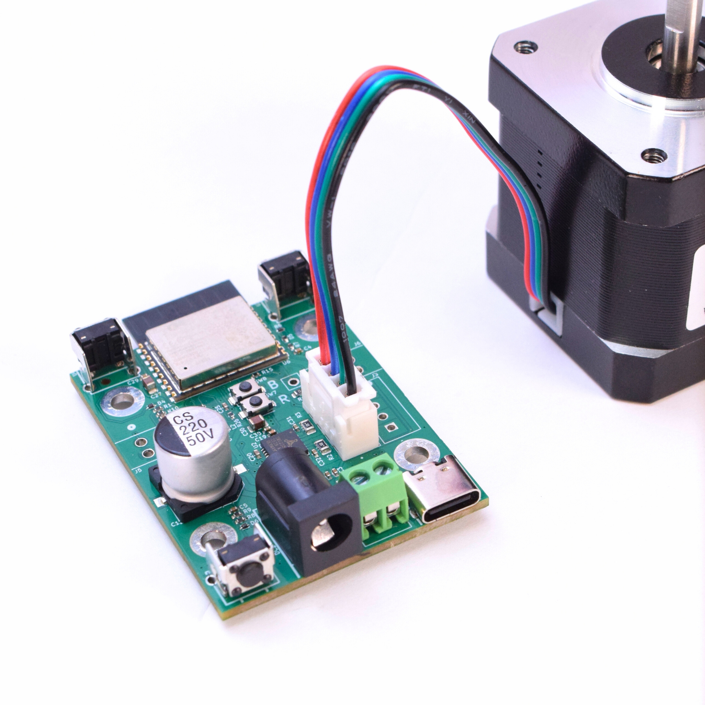
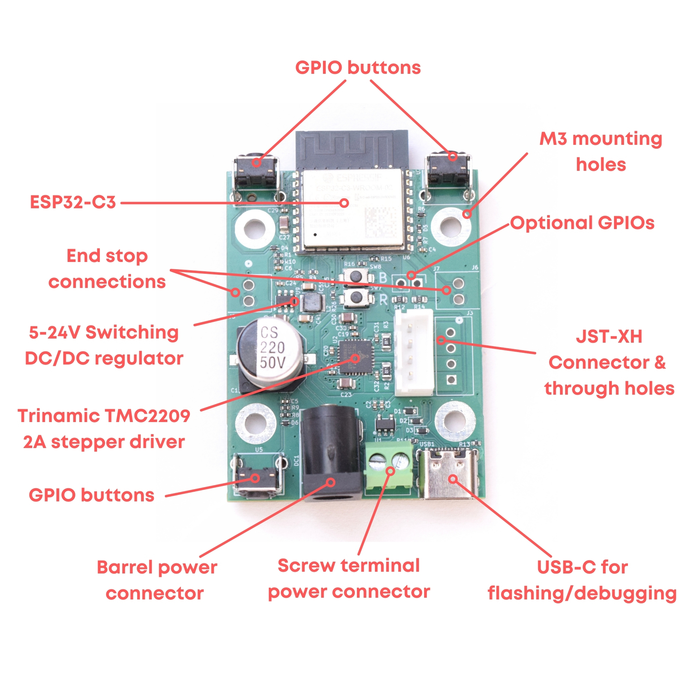

# Valar Motion — Valar Systems motor controllers

The easiest, fastest, cheapest, and safest way to spin a stepper motor
**wirelessly**. Valar Motion is a family of tiny Wi-Fi stepper controllers built
around a Trinamic **TMC2209** driver — precisely control a motor's distance,
speed, current, and stall behaviour within minutes of unboxing, from any browser,
with no Home Assistant required.

<p align="center">
  
</p>

All three boards share the same TMC2209 driver, a synchronous DC/DC converter,
three buttons, end-stop inputs, and a USB-C port for flashing. They differ only
in the microcontroller and — on the 3101 — an onboard magnetic encoder.

| Board | MCU | Radios | Extra | Price |
|-------|-----|--------|-------|-------|
| **VAL3000** | ESP32-C3 | Wi-Fi | — | $34.99 |
| **VAL3100** | ESP32-C6 | Wi-Fi / Thread / Zigbee / Matter / BLE | Status LED | $44.99 |
| **VAL3101** | ESP32-C6 | Wi-Fi / Thread / Zigbee / Matter / BLE | Status LED + AS5600 encoder (closed-loop) | $54.99 |

Buy them at [valarsystems.com](https://valarsystems.com). Sold out? Hit the
"Notify me when available" button — that's the only way we know to make more.

## What's on the board

The board packs a full wireless stepper controller into a footprint that bolts
onto the back of a **NEMA 17** motor (the four mounting holes line up with the
motor face):

- **Espressif ESP32** — Wi-Fi microcontroller with native USB (C3 on the VAL3000;
  C6 with Thread/Zigbee/Matter/BLE on the VAL3100/3101)
- **Trinamic TMC2209** stepper driver — silent StealthChop + sensorless StallGuard
- **5–24 V synchronous DC/DC converter** — efficient on-board regulation from the
  motor supply, no separate logic power needed
- **Three buttons** for manual open / close / Wi-Fi-reset
- **Flexible motor hookup** — on-board 4-pin JST-XH, a screw terminal, or solder
  wires straight to the pads
- **Barrel + screw-terminal power** inputs and a **USB-C** port for flashing

<p align="center">
  
  <br>
  <em>Board anatomy (VAL3000 shown; the VAL3100/3101 share the same layout on an ESP32-C6).</em>
</p>

## Quick start

Setup takes about three minutes:

1. Connect any bipolar (4-wire) stepper motor.
2. Connect a 12–24 V, 2 A+ power supply (2.1 × 5.5 mm barrel, **center positive**).
3. Press one of the buttons — the motor starts and stops.

That's it. When you're ready to customize, plug in USB-C and flash a build below.

> **⚠️ Warning:** the board has **no reverse-polarity protection**. Double-check
> your supply polarity (center positive) before powering on.

## Flash a board (the fast way)

The board ships bare. Grab the prebuilt binary for your board from the
[latest release](../../releases/latest) and flash it from your browser at
[web.esphome.io](https://web.esphome.io) with a USB-C cable — no toolchain, no
soldering, no Home Assistant required. On first boot the board makes its own
Wi-Fi hotspot; connect, join it to your network, and control it from any
browser. It's discoverable in Home Assistant over the ESPHome API too.

> First-time flashing note: the USB-C port connects straight to the ESP32 (USB
> CDC — no USB-to-UART bridge). If the board isn't detected on a brand-new unit,
> enter download mode manually: **hold** BOOT, **tap** RESET, then **release**
> BOOT. After the first upload this is automatic.

## Build from source

```bash
python3 -m venv venv && source venv/bin/activate
pip install esphome
cp secrets.example.yaml secrets.yaml     # not needed for a bare flash

esphome compile boards/val3100/val3100.yaml
# → factory image at:
#   boards/val3100/.esphome/build/val3100/.pioenvs/val3100/firmware.factory.bin
```

Swap `val3100` for `val3000` or `val3101`. CI
(`.github/workflows/build-firmware.yml`) builds all three on every push and
attaches `*.factory.bin` / `*.ota.bin` to tagged releases.

## Firmware updates (OTA)

Boards can update themselves over Wi-Fi — no computer needed — by fetching the
newest release asset for their board. **Release asset names are an API**: keep
`val3000.factory.bin`, `val3100.ota.bin`, etc. stable so units already in the
field keep updating after any repo move. See `docs/MIGRATION.md`.

## Detailed features

### Trinamic TMC2209 + StallGuard

The TMC2209 is one of the best stepper drivers on the market — feature-rich yet
affordable, with silent StealthChop operation and sensorless stall detection.
**StallGuard** stops the motor whenever the load exceeds a threshold you set — no
limit switches needed — which makes the board safe for curtains, windows, blinds,
and anything that could pinch or jam. The driver is controlled over a single-wire
UART, so speed, current, microstepping, and stall sensitivity are all tunable
live from the web UI.

### Flexible motor connector

Connect a motor three ways: the on-board 4-pin JST-XH plug, the included 4-pin
screw terminal (solder it to the exposed pins), or by soldering the motor wires
directly to the board.

### USB-C + three buttons

Flash firmware and monitor serial over USB-C — no programmer needed. Three
on-board buttons give physical open / close control plus a Wi-Fi reset, handy for
products built on the board (our Ropener curtain opener uses exactly this).

## Repository layout

```
valar-motion/
├── boards/
│   ├── val3000/val3000.yaml   # ESP32-C3 pin map + substitutions
│   ├── val3100/val3100.yaml   # ESP32-C6 + status LED
│   └── val3101/val3101.yaml   # ESP32-C6 + status LED + AS5600 encoder
├── common/
│   └── valar-core.yaml        # shared, board-independent behaviour
├── hardware/                  # PCB, schematics, libraries (per board)
├── docs/                      # datasheets, guides, media
└── .github/workflows/         # CI: builds a factory + OTA bin per board
```

The important idea: **behaviour lives in `common/valar-core.yaml`**, which every
board pulls in as a package. Each `boards/<board>/<board>.yaml` is a thin wrapper
that only sets that board's chip, GPIO pin map, and OTA asset name. Change the
core once and all three boards inherit it.

## Hardware & documentation

- **Hardware guide:** [`docs/hardware-guide.md`](docs/hardware-guide.md) — power/voltage/current/heat, driving the TMC2209 (UART vs STEP/DIR), and mounting to a NEMA 17
- **PCB / KiCad sources:** [`hardware/val3000`](hardware/val3000),
  [`hardware/val3100`](hardware/val3100) (the VAL3101 uses the VAL3100 board with
  the AS5600 encoder populated — see [`hardware/val3101`](hardware/val3101))
- **Schematic (PDF):** [`docs/val3000/schematic.pdf`](docs/val3000/schematic.pdf)
- **Trinamic book (PDF):** [`docs/val3000/Trinamic_Book_V4.pdf`](docs/val3000/Trinamic_Book_V4.pdf) — in-depth guide to Trinamic drivers
- **TMC2209 datasheet:** [analog.com](https://www.analog.com/media/en/technical-documentation/data-sheets/tmc2209_datasheet_rev1.09.pdf)

## Applications

This repo is the **board firmware**. Products built on these boards live in their
own repos and layer their behaviour on top of `common/valar-core.yaml` — e.g.
[The Ropener](https://github.com/Valar-Systems/Ropener), a smart curtain opener,
which adds cover/position logic and homing on the same boards.

## License

Licensed under the [CERN Open Hardware Licence Version 2 — Strongly Reciprocal](LICENSE).
