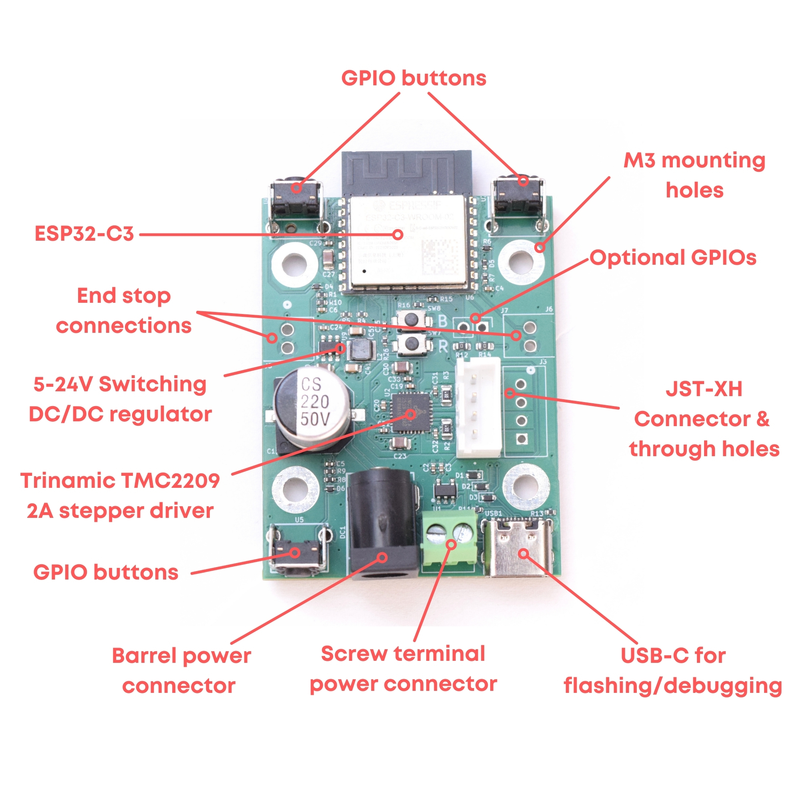

# Valar Motion — hardware guide

Power, thermal, motor-driving, and mounting notes for the Valar Motion boards.
Most of this applies to the whole family; where a **pin number** is given it is
for the **VAL3000 (ESP32-C3)** — the VAL3100/3101 are ESP32-C6 with a different
GPIO map, so for those consult each board's wrapper in
[`boards/<board>/<board>.yaml`](../boards).

> **⚠️ No reverse-polarity protection.** Double-check your supply is **center
> positive** before plugging it in.

  

## Power requirements

### Voltage

The recommended supply is **12–24 V** on the 2.1 × 5.5 mm barrel connector. The
component limits are:

1. The **TMC2209** operates from 4.75 V to 29 V.
2. The on-board **DC/DC switching regulator** operates from 3.8 V to 32 V.

For stepper motors, higher voltage allows more torque at higher speeds. A motor
can run at 5 V at full torque, but only if the speed is kept very low.

### Current

Current draw is set by the TMC2209's **IRUN** value. The board uses 0.1 Ω
(100 mΩ) current-sense resistors, giving a maximum motor current of **1.92 A RMS**
(see the datasheet, §8 "Selecting Sense Resistors").

Higher supply voltage lowers the current drawn *from the supply* — at 24 V the
draw is only ~1 A at slower speeds. Because IRUN is an RMS value, multiply by 1.4
for peak current: 1.92 × 1.4 ≈ **2.7 A**. If you plan to run maximum current at
high speed, size your supply for at least 2.7 A.

### Heat

More current means more heat. The TMC2209 can be pushed to ~2 A, but it will
likely hit its over-temperature limit and shut down — the motor starts to stutter
(move, pause, move, pause). Add a heatsink or fan if you need sustained high
current. **Recommended:** run at 24 V with current below 1 A, which keeps heat
generation low.

## Driving the TMC2209

There are two ways to drive the TMC2209, and the Valar Motion firmware uses the
second:

1. **STEP/DIR interface** *(not recommended)* — the MCU pulses the STEP pin, one
   microstep per pulse. This consumes the whole CPU, so the ESP32 can't do
   anything else — including Wi-Fi, which would cause the motor to stutter. Two
   0 Ω resistors connect the ESP32 to the STEP/DIR pins; remove them to free the
   pins (the large vias) for use as GPIO.
2. **Internal pulse generator** *(recommended — what this firmware uses)* — the
   driver is controlled over a single-wire UART. Set a target velocity and the
   TMC2209 generates the step pulses itself, leaving the ESP32 free for Wi-Fi,
   the API, and the web UI. Position is tracked by counting the driver's INDEX
   interrupt. Speed, current, microstepping, and StallGuard sensitivity are all
   tunable live.

## Pinout — VAL3000 (ESP32-C3)

The ESPHome firmware here controls the driver over **UART** (it does not use a
STEP pin); the STEP row below is relevant only if you drive the board via the
STEP/DIR interface described above. **This map is the ESP32-C3 board** — for the
ESP32-C6 VAL3100/3101, see their `boards/*.yaml`.

| Function | ESP32-C3 GPIO |
| --- | --- |
| TMC2209 UART RX | 5 |
| TMC2209 UART TX | 6 |
| TMC2209 STEP (STEP/DIR mode only) | 10 |
| TMC2209 ENABLE | 8 |
| TMC2209 DIAG (StallGuard) | 1 |
| TMC2209 INDEX | 0 |
| Button 1 | 3 |
| Button 2 | 4 |
| Button 3 (Wi-Fi reset) | 7 |

## First-time flashing

The USB-C port connects directly to the ESP32 (USB CDC — there is **no**
USB-to-UART bridge). The **first** time you flash a fresh board, enter download
mode manually: **press and hold** BOOT, **press and release** RESET, then
**release** BOOT. After one successful upload this happens automatically. (For
Arduino serial monitoring, set **Tools → USB CDC on Boot → Enabled**.)

## Mounting to a NEMA 17

The four mounting holes line up with a NEMA 17 motor face, so the board can bolt
directly onto the back of the motor. 3D-print standoffs, remove two of the
motor's M3 screws, and replace them with two screws about **7 mm longer** than
the ones you removed.

## References

- [Schematic (PDF)](val3000/schematic.pdf)
- [TMC2209 datasheet](https://www.analog.com/media/en/technical-documentation/data-sheets/tmc2209_datasheet_rev1.09.pdf)
- [Trinamic book (PDF)](val3000/Trinamic_Book_V4.pdf) — in-depth guide to Trinamic drivers
- [Controlling Trinamic Drivers (advanced guide, PDF)](https://valarsystems.com/products/controlling-trinamic-drivers-pdf)
